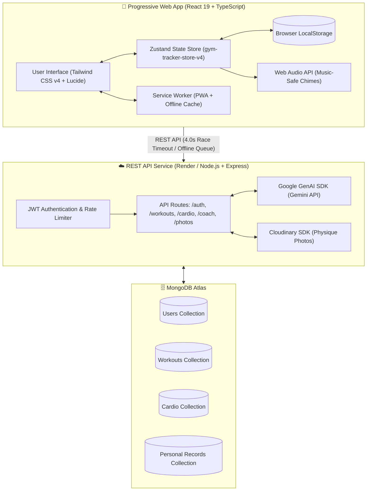

# 🏋️ GymTrackie — Intelligent Strength & Fitness Progression PWA

<div align="center">


[](https://gym-tracker-tawny-five.vercel.app)
[](https://gym-tracker-backend.onrender.com/api/health)
[](#-automated-testing--quality-assurance)
[](https://react.dev/)
[](https://www.typescriptlang.org/)
[](https://nodejs.org/)
[](https://www.mongodb.com/atlas)
[](https://ai.google.dev/)
[](https://tailwindcss.com/)

**An intelligent, offline-first progressive overload and fitness tracking Progressive Web App (PWA). Engineered for athletes, lifters, and fitness enthusiasts who demand data-driven progression, fatigue auto-regulation, superset support, and personalized coaching.**

[🚀 Explore Live App](https://gym-tracker-tawny-five.vercel.app) • [📖 Documentation](#-core-features--capabilities) • [🛠️ Local Setup](#-getting-started-locally) • [🧪 Test Suites](#-automated-testing--quality-assurance)

</div>

---

## 📌 Table of Contents

- [Overview](#-overview)
- [Core Features & Capabilities](#-core-features--capabilities)
  - [1. Adaptive Overload & Biomechanical Intelligence](#1-adaptive-overload--biomechanical-intelligence)
  - [2. Gemini-Powered AI Coach](#2-gemini-powered-ai-coach)
  - [3. Advanced Workout Execution & Combinations](#3-advanced-workout-execution--combinations)
  - [4. Non-Intrusive Audio Rest Timer](#4-non-intrusive-audio-rest-timer)
  - [5. Aerobic Conditioning & Cardio Tracking](#5-aerobic-conditioning--cardio-tracking)
  - [6. Offline-First Resilience & PWA Architecture](#6-offline-first-resilience--pwa-architecture)
  - [7. Analytics, 1RM Estimation & PR Tracking](#7-analytics-1rm-estimation--pr-tracking)
- [System Architecture](#-system-architecture)
- [Tech Stack](#-tech-stack)
- [Project Directory Structure](#-project-directory-structure)
- [REST API Specifications](#-rest-api-specifications)
- [Getting Started Locally](#-getting-started-locally)
  - [Prerequisites](#prerequisites)
  - [Environment Variables](#environment-variables)
  - [Installation & Running](#installation--running)
- [Automated Testing & Quality Assurance](#-automated-testing--quality-assurance)
- [Deployment](#-deployment)
- [Author & License](#-author--license)

---

## 💡 Overview

Most workout apps treat logging as a dumb spreadsheet. **GymTrackie** is engineered from the ground up as an athletic decision engine:

* It tracks **prime mover vs. synergist stimulus** (e.g., bench press provides 1.0 effective chest set, 0.5 triceps set, 0.5 front delt set) to avoid undertraining or overtraining.
* It calculates **acute fatigue windows** and warns when attempting heavy PR loads prematurely (`recovery window: hold working load, fresh in ~48h`).
* It supports modern high-intensity bodybuilding techniques: **Supersets, Drop Sets, Giant Sets, Tri-Sets, and Rest-Pause sets** with stage-by-stage load tracking.
* It works seamlessly **offline** inside the gym, queuing saves locally and syncing transparently with MongoDB Atlas when reconnected.
* It incorporates a **Gemini AI Coach** that inspects your live physiological snapshot (muscle readiness, volume tolerance, plateaus, and PR trends) without hallucinating fictional workouts.

---

## ✨ Core Features & Capabilities

### 1. Adaptive Overload & Biomechanical Intelligence
* **Dynamic Target Calculation**: Evaluates session-to-session velocity, RPE, and rep milestones to calculate exact next-session weights and rep ranges.
* **Acute Fatigue Protection**: When a muscle has been trained within the last 48 hours, progression buttons adapt from *"Apply in Workout"* to *"Stage for Next Session"*, preventing reckless PR attempts under acute fatigue.
* **Surface Invariance**: Recommendations displayed on the Home Dashboard, Progression Insight Cards, and Weekly Coaching drawer match verbatim with identical underlying rationale.
* **Plateau Detection & Deload Protocols**: Detects stagnant lifts across 3+ exposures and suggests eccentric tempos, grip variations, or subregion angle rotations.

### 2. Gemini-Powered AI Coach
* **Conversational Drawer**: Instant-access floating coach offering analysis on strength trends, plateau breakdowns, lagging muscle groups, and periodization advice.
* **Client Intelligence Snapshot**: Feeds verified training metrics (effective volume, muscle readiness, recent 1RM deltas) into the prompt context for zero-hallucination, evidence-backed advice.
* **Starter Prompts**: Includes one-tap prompt templates (*"Analyse my strength progress"*, *"Why am I plateauing?"*, *"Which muscles need more attention?"*).

### 3. Advanced Workout Execution & Combinations
* **Complex Multi-Movement Stages**: Log antagonistic supersets, agonist drop-sets, giant sets, and rest-pause intervals with per-stage weights and reps.
* **Atomic 1-Tap Completion**: Collapse and finalize exercises with single-tap completion, haptic feedback, and automatic set validation.
* **Interactive Demonstration Media**: Exercise library modal showcasing proper exercise mechanics, starting positions, target muscles, and execution cues.
* **Reorder & Customize**: Move exercises up/down within active workouts, add custom exercises, and attach per-set notes (seat height, tempo, feel).

### 4. Non-Intrusive Audio Rest Timer
* **Smart Rest Allocation**: Automatically assigns **180 seconds** for heavy compound lifts (Squats, Deadlifts, Bench Press) and **90 seconds** for isolation/cable lifts.
* **Background Audio Friendly**: Plays synthesized, gentle Web Audio chimes that immediately release audio focus—**never pausing or hijacking your Spotify, Apple Music, or YouTube Music streams**.
* **Dynamic Title & Notifications**: Live `(01:30) Rest` countdown in document tab title, flashing indicators on set readiness, and Service Worker background notifications.

### 5. Aerobic Conditioning & Cardio Tracking
* **7 Specialized Cardio Activities**: Dedicated tracking for Running, Outdoor/Stationary Cycling, Rowing, Jump Rope, HIIT, Swimming, and Stair Climber.
* **Performance Metrics**: Automatic calculation of pace (min/km), speed (km/h), cadence/strokes, elevation gain, and estimated caloric expenditure.
* **Heart Rate & Intensity Zones**: Zone 1 (Active Recovery) through Zone 5 (Neuromuscular Max) duration breakdown.
* **Cardio Goals**: Set weekly distance, duration, or session frequency targets with visual progress rings.

### 6. Offline-First Resilience & PWA Architecture
* **Zustand Local Storage Sync**: All workout logs, edits, and active sessions are persisted locally on the device instantly.
* **Optimistic Cloud Reconciliation**: Requests to MongoDB Atlas are dispatched with graceful timeout guards; pending sessions display clean sync indicators with manual *"Sync Now"* fallback.
* **Mobile PWA Ready**: Installable on iOS (Safari *Add to Home Screen*) and Android Chrome with offline service worker caching and standalone display mode.

### 7. Analytics, 1RM Estimation & PR Tracking
* **Epley Formula 1RM Engine**: Automatic calculation of estimated 1 Rep Max ($1\text{RM} = w \cdot (1 + r/30)$) across every completed working set.
* **Personal Record Badges**: Live recognition of All-Time Max Weight, Max Estimated 1RM, Max Reps, and Session Volume records with celebratory badges.
* **28-Day Consistency Heatmap**: Calendar visualizing training cadence, split distribution, and volume density over the trailing 4 weeks.

---

## 🏗️ System Architecture



---

## 🛠️ Tech Stack

| Layer | Technologies |
| :--- | :--- |
| **Frontend** | React 19, TypeScript 6.0, Vite 8, Tailwind CSS v4, Zustand 5, Lucide React, KaTeX |
| **Backend** | Node.js, Express.js, TypeScript, Mongoose 8, JWT, Bcrypt.js, Express Rate Limit |
| **Artificial Intelligence** | Google Gemini API (`@google/genai`), Custom Adaptive Decision Engine |
| **Database & Media** | MongoDB Atlas, Cloudinary Media CDN |
| **Tooling & Linter** | Git, GitHub, Oxlint, TSX, Vitest Architecture |
| **Deployment** | Vercel (Frontend PWA), Render (REST Backend), MongoDB Cloud (Database) |

---

## 📂 Project Directory Structure

```
GYM APP/
├── client/                              # Frontend React 19 Application
│   ├── public/                          # Favicons, PWA manifest, service-worker
│   ├── src/
│   │   ├── api/                         # Axios/Fetch API client functions
│   │   ├── components/
│   │   │   ├── cardio/                  # Cardio session modals, cards & metrics
│   │   │   ├── coach/                   # AI Coach sliding drawer & prompts
│   │   │   ├── layout/                  # Header, navigation bars, bottom tab bar
│   │   │   ├── progress/                # Progression cards, PR lists, 1RM charts
│   │   │   ├── ui/                      # Modals, buttons, cards, badges
│   │   │   └── workout/                 # ExerciseCard, CombinationCard, RestTimer
│   │   ├── pages/                       # Home, Workout, Exercises, History, Progress, Settings
│   │   ├── store/                       # Zustand stores (workout, auth, timer, coach)
│   │   ├── types/                       # TypeScript interfaces & domain models
│   │   └── utils/
│   │       ├── adaptiveDecisionEngine.ts# Biomechanical overload & recovery engine
│   │       ├── analyticsEngine.ts       # Volume, consistency & streak calculators
│   │       ├── combinationNormalizer.ts # Superset / drop set data transformers
│   │       ├── muscleIntelligence.ts    # Synergist & subregion distribution
│   │       ├── timerAudio.ts            # Web Audio chime synthesis (zero music hijacking)
│   │       └── __tests__/               # 25 automated unit & integration test suites
│   ├── package.json
│   ├── vite.config.ts
│   └── tsconfig.json
│
├── server/                              # Backend Express REST Application
│   ├── src/
│   │   ├── config/                      # MongoDB & Cloudinary connections
│   │   ├── middleware/                  # JWT auth token guards, error handlers
│   │   ├── models/                      # User, Workout, Cardio, Exercise schemas
│   │   ├── routes/                      # Auth, Workout, Cardio, Coach, Upload routes
│   │   └── scripts/                     # Exercise database seed & migration scripts
│   ├── package.json
│   └── tsconfig.json
│
├── .gitignore
└── README.md
```

---

## 🔌 REST API Specifications

The production backend is hosted at `https://gym-tracker-backend.onrender.com`.

### Authentication Endpoints
| Method | Endpoint | Description | Protected |
| :--- | :--- | :--- | :--- |
| `POST` | `/api/auth/register` | Create a new user account with hashed password | No |
| `POST` | `/api/auth/login` | Authenticate with email/password and obtain JWT token | No |
| `POST` | `/api/auth/google` | Authenticate or register with Google OAuth ID token | No |
| `GET` | `/api/auth/me` | Fetch authenticated user profile & preferences | **Yes** |

### Workout & Progression Endpoints
| Method | Endpoint | Description | Protected |
| :--- | :--- | :--- | :--- |
| `GET` | `/api/workouts` | Retrieve user's historical workout sessions | **Yes** |
| `POST` | `/api/workouts` | Save a completed workout (with client session deduplication) | **Yes** |
| `PUT` | `/api/workouts/:id` | Update / edit an existing workout log | **Yes** |
| `DELETE` | `/api/workouts/:id` | Remove a workout session and re-aggregate PRs | **Yes** |
| `GET` | `/api/workouts/prs` | Fetch verified all-time personal records | **Yes** |

### Cardio & Conditioning Endpoints
| Method | Endpoint | Description | Protected |
| :--- | :--- | :--- | :--- |
| `GET` | `/api/cardio` | Retrieve logged cardio activities | **Yes** |
| `POST` | `/api/cardio` | Log a new running, cycling, rowing, or HIIT session | **Yes** |
| `DELETE` | `/api/cardio/:id` | Delete a cardio session | **Yes** |

### AI Coach & Media Endpoints
| Method | Endpoint | Description | Protected |
| :--- | :--- | :--- | :--- |
| `POST` | `/api/coach/chat` | Send training snapshot to Gemini AI coach for insights | **Yes** |
| `POST` | `/api/upload/photo`| Upload progress/physique picture to Cloudinary CDN | **Yes** |
| `GET` | `/api/health` | Service uptime and MongoDB connectivity ping | No |

---

## 🚀 Getting Started Locally

### Prerequisites
* **Node.js** v20.0+ installed
* **npm** v10.0+ installed
* **MongoDB** instance (local or MongoDB Atlas connection URI)

### Environment Variables

#### 1. Backend (`server/.env`)
```env
PORT=5001
NODE_ENV=development
MONGODB_URI=mongodb+srv://<username>:<password>@cluster.mongodb.net/gymtrackie?retryWrites=true&w=majority
JWT_SECRET=your_super_secret_jwt_key_at_least_32_characters
GEMINI_API_KEY=your_gemini_api_key_here
CLOUDINARY_CLOUD_NAME=your_cloud_name
CLOUDINARY_API_KEY=your_cloudinary_key
CLOUDINARY_API_SECRET=your_cloudinary_secret
```

#### 2. Frontend (`client/.env`)
```env
VITE_API_BASE_URL=http://localhost:5001/api
```

### Installation & Running

#### 1. Clone repository
```bash
git clone https://github.com/sruju22/gym-tracker.git
cd gym-tracker
```

#### 2. Setup and run Backend Server
```bash
cd server
npm install
npm run dev
# Server running at http://localhost:5001
```

#### 3. Setup and run Frontend Client (in a separate terminal)
```bash
cd client
npm install
npm run dev
# Vite client running at http://localhost:5173
```

---

## 🧪 Automated Testing & Quality Assurance

GymTrackie enforces complete algorithmic integrity via **25 dedicated automated test suites**, verifying calculations, concurrency, offline sync, and decision engines:

```bash
cd client
npm run test:all
```

### Key Verified Test Suites:
1. `test:recommendations` — Target muscle filtering, goal ranking, equipment availability.
2. `test:combinations` — Volume attribution across Supersets, Drop Sets, and Rest-Pause intervals without double counting.
3. `test:analytics` — Streak logic, calendar week boundaries, and Epley 1RM math.
4. `test:reconciliation` — Merging local cached workouts with remote MongoDB Atlas records.
5. `test:offline` — Offline mutation queueing and recovery on network reconnect.
6. `test:progression:unified` — Adaptive overload logic, rep target expansion, and load holds.
7. `test:muscle:intelligence` — Subregion distribution, synergist effective set calculations (0.5 vs 1.0).
8. `test:adaptive:decision` — Acute fatigue thresholds, rest interval timing, and surface-invariant advice.
9. `test:coach:ui` — Gemini AI coach context extraction, starter prompts, and zero canned responses.
10. `test:timer` — Music-safe audio synthesis, non-hijacking audio context, and 180s/90s lift allocation.

---

## ☁️ Deployment

* **Frontend**: Continuous Deployment on [Vercel](https://gym-tracker-tawny-five.vercel.app) automatically tracking pushes to `main`.
* **Backend**: Production REST service deployed on [Render](https://gym-tracker-backend.onrender.com) with automatic build and health-check monitoring.
* **Database**: High-availability multi-region cluster on **MongoDB Atlas**.

---

## 👨‍💻 Author

**Srujan**  
*Computer Science & Engineering*  
🔗 GitHub: [@sruju22](https://github.com/sruju22)  
📧 Live Application: [GymTrackie on Vercel](https://gym-tracker-tawny-five.vercel.app)

---

## 📄 License

This repository is maintained for personal use, continuous athletic progression, and technical showcase. All rights reserved.
